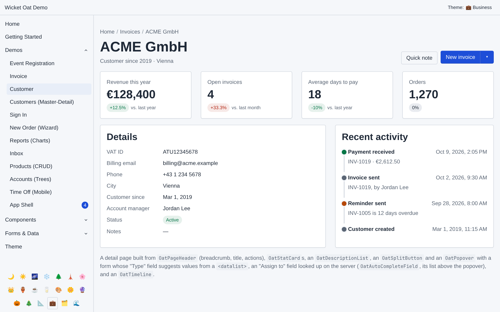
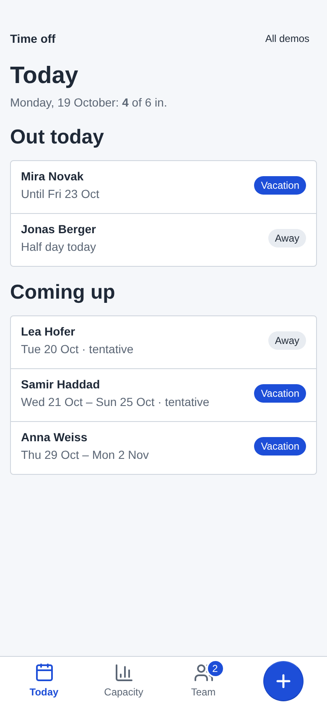
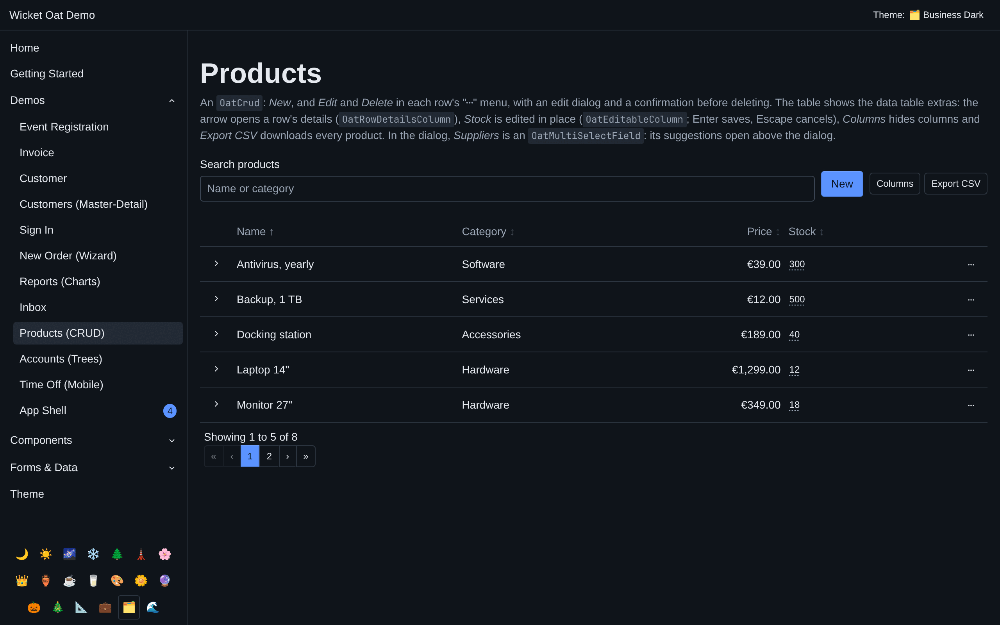
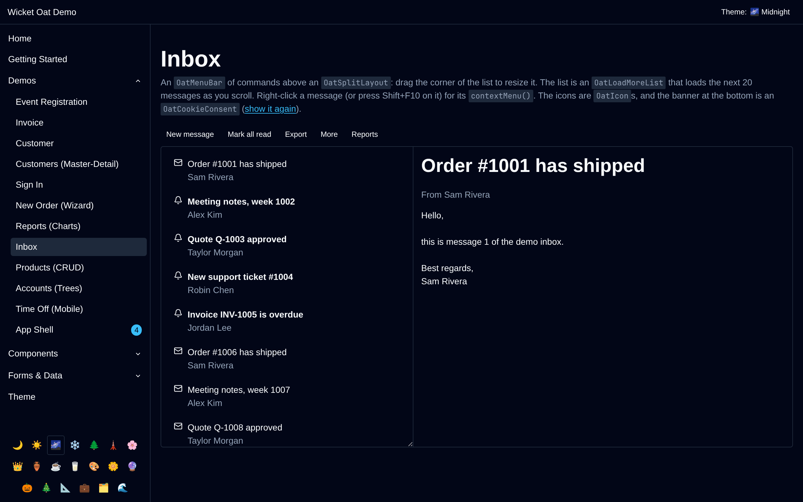

# Wicket Oat

[](https://github.com/danielbartl/wicket-oat/actions/workflows/build.yml)

Wicket Oat is a modern, lightweight, and themeable UI component library for [Apache Wicket](https://wicket.apache.org/). It provides a set of high-quality components and behaviors built on top of a sleek, modern design system.

**[Live demo](https://wicket-oat-production.up.railway.app/)** &middot; **[Website](https://danielbartl.github.io/wicket-oat/)** &middot; **[User guide](https://danielbartl.github.io/wicket-oat/guide.html)** &middot; **[Step-by-step tutorial](https://danielbartl.github.io/wicket-oat/tutorial.html)**

<table>
  <tr>
    <td width="77%"><a href="docs/screenshots/customer.png"></a><br><sub>A detail page: header, key figures, details and a timeline (Business theme)</sub></td>
    <td width="23%"><a href="docs/screenshots/phone.png"></a><br><sub>A phone app with a bottom tab bar</sub></td>
  </tr>
</table>
<table>
  <tr>
    <td width="33%"><a href="docs/screenshots/reports.png"></a><br><sub>Charts and key figures, rendered on the server</sub></td>
    <td width="33%"><a href="docs/screenshots/products-dark.png"></a><br><sub>A CRUD data table (Business Dark theme)</sub></td>
    <td width="33%"><a href="docs/screenshots/inbox-midnight.png"></a><br><sub>A menu bar and a split layout (Midnight theme)</sub></td>
  </tr>
</table>

<sub>Screens from the examples app, which runs as the [live demo](https://wicket-oat-production.up.railway.app/).</sub>

## Features

- **Wicket-Style API:** Plain Wicket components, created with `new` and bound to models. Components driven by a callback also have lambda factories, like Wicket's own `AjaxLink.onClick(...)`: `OatButton.onClick("save", "Save", target -> ...)`.
- **Modern Design:** Beautifully designed components like Buttons, Cards, Modals, and more.
- **Themeable:** Built-in support for multiple themes (Light, Dark, Midnight, Nord, etc.) that can be switched dynamically.
- **Wicket 10+:** Fully compatible with Apache Wicket 10, on Java 17 or newer.
- **Spring Boot Integration:** Seamless integration with Spring Boot applications.
- **Comprehensive Component Set:** Includes everything from basic buttons to complex data tables.
- **Accessible Forms by Default:** Every form field automatically wires `aria-describedby` (linking the field to its feedback/hint message) and toggles `aria-invalid` when validation fails — no extra markup or wiring required.
- **Wicket-Style Forms:** Form fields work with `CompoundPropertyModel`, take their labels from `.properties` files, and re-render via Ajax like any Wicket component (see [Forms](#forms)).
- **Translated:** The library's own texts (dialog buttons, menu toggle, upload hints, validation messages, ...) come in English, German, Spanish, French, Italian, Japanese, Dutch and Portuguese, following the component's locale like Wicket's own messages (see [Translations](#translations)).

## Quick Start

### 1. Add Dependency

Add the following dependency to your `pom.xml`:

```xml
<dependency>
    <groupId>dev.jbaby</groupId>
    <artifactId>wicket-oat-core</artifactId>
    <version>0.4.0</version>
</dependency>
```

### 2. Install Wicket Oat

In your Wicket `WebApplication` class, call `WicketOats.install(this)` in the `init()` method:

```java
public class MyWicketApplication extends WebApplication {
    @Override
    protected void init() {
        super.init();
        
        // Install Wicket Oat components and styles
        WicketOats.install(this);
    }
}
```

### 3. Use Components

Oat components are plain Wicket components: create them with `new`, like any
other, and give them a tag in your markup:

```java
add(new OatAlert("myAlert", "Your changes were saved.", OatVariant.SUCCESS));   // <div wicket:id="myAlert"></div>
add(new OatBadge("myBadge", "New", OatVariant.SUCCESS));                       // <span wicket:id="myBadge"></span>
```

Components whose behavior comes from a callback, such as a button's click, also
have a static factory taking a lambda, as Wicket's `AjaxLink.onClick(...)` does,
so you don't have to write an anonymous subclass:

```java
add(OatButton.onClick("myButton", "Click Me", target ->                        // <a wicket:id="myButton"></a>
        Oat.toast(target, "Hello from Wicket Oat!", OatVariant.SUCCESS)));
```

## Available Components

- **General:** `OatButton`, `OatSplitButton`, `OatBadge`, `OatIndicator`, `OatStatus`, `OatAvatar`, `OatAvatarGroup`, `OatAlert`, `OatCard`, `OatStatCard`, `OatEmptyState`, `OatFeedbackPanel`, `OatIcon`, `OatCookieConsent`
- **Navigation/Layout:** `OatAppLayout`, `OatMobileLayout`, `OatBottomNav`, `OatPageHeader`, `OatMenuBar`, `OatWizard`, `OatSteps`, `OatMasterDetail`, `OatSplitLayout`, `OatAccordion`, `OatButtonGroup`, `OatBreadcrumb`, `OatPagingNavigator`, `OatAjaxPagingNavigator`, `OatPagination`
- **Overlays:** `OatDialog`, `OatConfirmDialog`, `OatDropdown`, `OatPopover`, `OatTabbedPanel`, `OatTabs`
- **Charts:** `OatBarChart`, `OatColumnChart`, `OatLineChart`, `OatDonutChart`, `OatSparkline`
- **Data Display:** `OatDataTable`, `OatList`, `OatDescriptionList`, `OatTimeline`, `OatMessageList`, `OatLoadMoreList`, `OatLazyLoadPanel`, `OatProgress`, `OatRadialProgress`, `OatMeter`, `OatRating`, `OatSkeleton`, `OatSpinner`
- **Records & Trees:** `OatCrud`, `OatTree`, `OatTableTree`; data table columns `OatRowDetailsColumn`, `OatEditableColumn`
- **Forms:** `OatMultiSelectField`, `OatTextField`, `OatCheckBox`, `OatDropdownChoice`, `OatRadioChoice`, `OatCheckBoxMultipleChoice`, `OatListMultipleChoice`, `OatTextArea`, `OatSwitch`, `OatRatingField`, `OatTagInput`, `OatFileUpload`, `OatFileDropzone`, `OatMoneyField`, `OatPercentField`, `OatDateRangeField`, `OatAutoCompleteField`, `OatCustomField`, `OatLoginForm`, `OatMessageInput`, `OatFieldset`, and more specialized HTML5 fields.

### Variants

Every component and behavior with a color variant takes the same
`OatVariant` enum: `DEFAULT`, `SECONDARY`, `SUCCESS`, `WARNING`, `DANGER`.
Oat's CSS styles them per component: buttons support `SECONDARY` and `DANGER`,
badges all of them, and alerts and toasts `SUCCESS`, `WARNING` and `DANGER`;
any other variant renders like `DEFAULT`.

## Architecture: Components vs. Behaviors

Wicket Oat provides both **Components** and **Behaviors** for almost every UI element. This dual approach gives you maximum flexibility depending on your needs.

### When to use Components
Use a component when you want a self-contained UI widget and don't want to worry about the underlying HTML structure.
- **Pros:** Easiest to use; encapsulates markup logic; handles internal structure (like headers/footers in a Card).
- **Example:** `add(new OatAlert("id", "Saved!", OatVariant.SUCCESS))`
- **Markup Requirement:** Requires a simple tag like `<div wicket:id="id"></div>`.

### When to use Behaviors (`Oat.Behaviors`)
Use a behavior when you want to "Oat-ify" an existing Wicket component. This is the power of **Composition over Inheritance**.
- **Pros:** Highly flexible; can be applied to *any* component (Links, Labels, Containers); keeps your component hierarchy clean.
- **Example:** `myWicketLink.add(Oat.Behaviors.button())` — This turns a standard Wicket `Link` into a styled Oat button without changing the Java class of the link.
- **Markup Requirement:** You provide the markup (e.g., an `<a>` or `<button>` tag) and the behavior ensures the correct CSS classes and attributes are applied.

### Summary Comparison

| Feature | Component | Behavior |
| :--- | :--- | :--- |
| **Philosophy** | "Give me an Alert" | "Make this thing look like an Alert" |
| **Java Usage** | `new OatAlert(...)` | `anyComponent.add(new AlertBehavior())` |
| **Markup** | Handled by Oat | Handled by You |
| **Best For** | Quick UI building | Customizing existing Wicket logic |

## Usage Strategies

Wicket Oat components are plain Wicket components, so you create them with `new`,
subclass them, and give them models as you would any other.

### Components driven by a callback
`OatButton`, `OatSubmitButton`, `OatTabs`, `OatAccordion`, `OatButtonGroup`,
`OatBreadcrumb`, `OatPagination`, `OatDropdown`, `OatAvatarGroup`, `OatWizard`,
`OatLoginForm` and `OatLazyLoadPanel` get their behavior from a method you
implement, like `onClick` or `populateItem`. Override it in an anonymous subclass,
as with Wicket's `AjaxLink` or `ListView`, or use the class's static factory, which
takes a lambda instead:

```java
// The factory implements onClick() for you
add(OatButton.onClick("id", "Click Me", target -> ...));                   // <a wicket:id="id"></a>

// A form's submit button: onSubmit when valid, onError when not
form.add(OatSubmitButton.onSubmit("save", "Save", target -> ..., target -> target.add(form)));

// List components fill each item from its object
add(OatAccordion.of("faq", Model.ofList(faqs), (item, faq) -> {
    item.add(new Label("title", faq.question()));
    item.add(new Label("content", faq.answer()));
}));
```

`Oat.Components` has the same factories in one place (`Oat.Components.button(...)`,
`Oat.Components.accordion(...)`, ...), for code that prefers a single entry point.

### Everything else
Every other component - `OatAlert`, `OatBadge`, `OatCard`, `OatDialog`,
`OatDataTable`, the form fields and the rest - is complete as it is, so you create
it with its constructor:
```java
add(new OatAlert("id", "Saved!", OatVariant.SUCCESS));
form.add(new OatTextField<String>("name").setRequired(true));
```

`OatDialog` works like Wicket's own `ModalDialog`, on the native `<dialog>`
element: set its content with `setContent(...)` (id `OatDialog.CONTENT_ID`), and
open and close it from any Ajax handler with `dialog.open(target)` /
`dialog.close(target)`. It validates the form fields in its content when Confirm is
clicked, staying open to show any errors:

```java
OatDialog editDialog = new OatDialog("editDialog", Model.of("Edit person")) {
    @Override
    protected void onConfirm(AjaxRequestTarget target) {
        success("Saved."); // closes afterwards, unless an error was reported here
    }

    @Override
    protected void onClose(AjaxRequestTarget target) {
        selectedPerson.setObject(null); // saved, cancelled, Escape or a click beside it
    }
};
editDialog.setContent(new PersonFieldsPanel(OatDialog.CONTENT_ID, selectedPerson));

// e.g. in a table row's AjaxLink:
selectedPerson.setObject(person);
editDialog.open(target);
```

The server knows whether the dialog is open (`isOpen()`): Cancel, the Escape key
and a click on the backdrop close it in the browser and tell the server, and
`onClose` runs once however it closed. Re-rendering it with `target.add(dialog)`
keeps an open dialog open. `open(content, target)` sets content that is removed
again when the dialog closes, e.g. the fields for the row that was clicked; opened
again in `onConfirm` or `onClose`, e.g. for the next record, it stays open. Give it
a tag of its own, such as `<div wicket:id="editDialog"></div>`, which takes no room
in the layout. On a `<wicket:container>`, which Wicket leaves out in deployment mode,
`open` and `close` still work, but `target.add(dialog)` doesn't.

### Going further: subclassing and composition
Every component has a public constructor, so you can extend `OatButton`,
`OatAlert`, etc., just like any other Wicket component:
```java
public class MyBusinessButton extends OatButton {
   // Your complex business logic here
}
```
Or keep your own class hierarchy entirely and use behaviors to apply the Oat
look to it — the most flexible option when a component already has its own
base class:
```java
public class MyComplexActionLink extends AjaxLink<Void> {
    public MyComplexActionLink(String id) {
        super(id);
        add(Oat.Behaviors.button().setVariant(OatVariant.SECONDARY));
    }
}
```

## App Shell

### Sidebar menu

`OatAppLayout` builds its sidebar from `sidebarMenuItemsModel()`. Links can be
grouped into collapsible sections, open while one of their pages is shown, and
can carry a badge, such as a count:

```java
@Override
protected IModel<List<MenuItem>> sidebarMenuItemsModel() {
    return Model.ofList(List.of(
            MenuItem.of("Dashboard", DashboardPage.class),
            MenuItem.group("Sales",
                    MenuItem.of("Orders", OrdersPage.class).withBadge(() -> orders.countOpen()),
                    MenuItem.of("Invoices", InvoicesPage.class)),
            MenuItem.of("Settings", SettingsPage.class)));
}
```

A badge is read on every render and hidden while it is `null`, empty or zero.
To update it without reloading the page, re-render the sidebar from an Ajax
handler with `target.add(getSidebar())`. Pages the user isn't authorized to open are
left out, and so is a group left empty. Groups can't contain other groups.

Each entry's link is a `BookmarkablePageLink` to its page; override
`newMenuLink(id, item)` to return another link, such as an `AjaxLink`. Components of
your own go in the top bar with `newTopNavExtra(id)` and under the menu with
`newSidebarFooter(id)`.

### Page language and skip link

`OatAppLayout` sets the page's `lang` on `<html>` from its locale (the session's,
unless you override `getLocale()`), so screen readers pronounce the content in
the right language. Its first element is a "Skip to content" link: hidden until
it gets keyboard focus, it moves focus past the top navigation and sidebar to
`<main id="oat-main">`.

### Busy buttons

For a slow action, a button can show that it's working: with
`setBusyIndicator(true)`, an `OatButton` or `OatSubmitButton` shows a spinner
(`aria-busy="true"`) while it waits for its Ajax request, and further clicks send
nothing, so the action can't run twice. `OatDialog` has the same setter for its
confirm button, and `Oat.Behaviors.ajaxBusy()` adds it to any other Ajax link or
button:

```java
form.add(OatSubmitButton.onSubmit("save", "Save", target -> ...).setBusyIndicator(true));
add(new AjaxLink<Void>("refresh") { ... }.add(Oat.Behaviors.ajaxBusy()));
```

This needs `WicketOats.install(this)`, which hooks it into the requests.

### Confirming an action

`OatConfirmDialog` asks before an action runs. Add one to the page and `ask` it
from any Ajax handler with the action to run; one dialog serves any number of
buttons, e.g. a Delete button on every table row:

```java
OatConfirmDialog confirm = new OatConfirmDialog("confirm"); // <div wicket:id="confirm"></div>
add(confirm);

add(OatButton.onClick("delete", "Delete", target ->
        confirm.ask(target, "Delete invoice?", "This can't be undone.", t -> {
            invoices.delete(invoice);
            t.add(table);
        })));
```

The action stays on the server until the user answers, and runs at most once.
The confirm button is a danger button by default; `setConfirmLabel(...)` and
`setConfirmVariant(...)` change it.

### Loading slow content

`OatLazyLoadPanel` renders the page first and loads slow content over Ajax right
after, showing Oat skeleton lines until it arrives:

```java
add(OatLazyLoadPanel.of("revenue", id -> new RevenuePanel(id, reports.revenueThisYear()))
        .setPlaceholder(SkeletonBehavior.Shape.LINE, 2));
```

It extends Wicket's `AjaxLazyLoadPanel`, so it can also wait for background work:
override `isContentReady()`.

## Bottom Navigation for Phones

`OatBottomNav` is a tab bar fixed to the bottom of the screen, for an app's three
to five main pages: each tab an icon above a short label. Oat has no tab bar, so
`wicket-oat.css` builds one from Oat's own variables; it follows the theme, light or dark.
`OatMobileLayout` is a base page with the content in `<main>` and the bar after it:

```java
public abstract class TimeOffPage extends OatMobileLayout {

    @Override
    protected IModel<List<BottomNavItem>> bottomNavItemsModel() {
        return Model.ofList(List.of(
                BottomNavItem.of("Today", TodayPage.class).withIcon(Icon.sprite("today")),
                BottomNavItem.of("Team", TeamPage.class).withIcon(Icon.named("users"))
                        .withBadge(() -> requests.countOpen())
                        .withActive(page -> page instanceof TeamPage || page instanceof MemberPage),
                BottomNavItem.of("Add absence", AddAbsencePage.class).withIcon(Icon.named("plus")).asPrimary()));
    }
}
```

- **Icons:** Wicket Oat ships no icon set for the bar. `Icon.sprite("today")` draws a
  symbol of an SVG sprite your page supplies (`<svg aria-hidden="true"><use href="#today"/></svg>`),
  `Icon.svg("<svg ...>...</svg>")` writes an SVG into the page as it is, so pass only
  markup you trust, never user input, and `Icon.named("users")` uses one of `OatIcon`'s
  icons. Draw sprites and SVGs with `currentColor`, so they take the tab's color.
- **Current tab:** the tab whose page is shown gets `aria-current="page"` and the
  primary color. By default that's the item's page class (and its parameters, if it
  has any); `withActive(...)` replaces the rule, e.g. for pages that belong to a tab
  without being its target.
- **Badge:** `withBadge(...)` shows a count on the icon, read on every render and
  hidden while `null` or 0. `OatMobileLayout`'s `bottomNav` has a markup id, so
  `target.add(getBottomNav())` updates it over Ajax.
- **Primary item:** `asPrimary()` makes one item the bar's main action, a round Oat
  button showing only its icon; screen readers get its label as `aria-label`. It never
  takes the current tab's color, so its icon stays readable on the button.
- **Wide screens:** the bar shows up to 768px, where Oat's grid switches to phones too.
  `setAlwaysVisible(true)` keeps it on wider screens, e.g. from `newBottomNav(...)`.
- **The `<nav>`** is named "Main" for screen readers (`OatBottomNav.label`, translated);
  change it with `setLabel(...)` or an `aria-label` in the markup. Tabs for pages the
  user may not open are left out. Override `newLink(id, item)` to use, for example, an
  `AjaxLink` instead of a `BookmarkablePageLink`.

Without `OatMobileLayout`, put the bar on a `<nav>` with `new OatBottomNav(id, items)`,
and keep your content clear of it:

```css
main {
    padding-block-end: calc(var(--oat-bottom-nav-height) + env(safe-area-inset-bottom, 0px));
}
```

On an iPhone, the bar keeps clear of the home indicator only if the page's viewport
meta tag has `viewport-fit=cover`, as `OatMobileLayout`'s does:
`<meta name="viewport" content="width=device-width, initial-scale=1, viewport-fit=cover"/>`.
The bar's rules are in `wicket-oat.css`; set `--oat-bottom-nav-max-width` (28rem) to
line the tabs up with a wider content column.

## Feedback Messages

Wicket's `info()`, `success()`, `warn()` and `error()` messages can be shown as
Oat alerts or as Oat toasts:

```java
// A FeedbackPanel that renders each message as an alert of the matching variant
add(new OatFeedbackPanel("feedback"));

// ...or show them as toasts - add this to your base page to cover every page
add(Oat.Behaviors.feedbackToasts());
```

Both update themselves during Ajax requests, so an event handler only needs to
call `success("Saved.")` - no `target.add(...)` or `Oat.toast(...)`. The toasts
also pick up session messages, so a `getSession().success(...)` before
`setResponsePage(...)` appears on the next page. Both leave out the errors that
Oat form fields already show inline; pass your own `IFeedbackMessageFilter` to
change what they show.

## Tabs

`OatTabbedPanel` is Wicket's `AjaxTabbedPanel` with Oat styling: tabs are
`ITab`s, only the selected tab's panel is created, and switching swaps it over
Ajax. `Oat.tab(...)` builds a tab from a panel factory:

```java
add(new OatTabbedPanel<>("tabs", List.of(
        Oat.tab("Profile", ProfilePanel::new),
        Oat.tab("Settings", SettingsPanel::new))));
```

`OatTabs` instead renders every panel up front and switches between them in
the browser, for small static content.

## Page Building Blocks

The parts most business pages are made of: a header, key figures, the record's
details, and actions.

```html
<header wicket:id="pageHeader">          <!-- the content becomes the actions -->
    <div wicket:id="quickNote"></div>
    <div wicket:id="newInvoice"></div>
</header>
<div class="row">
    <article wicket:id="revenue" class="col-3"></article>
</div>
<dl wicket:id="details"></dl>
```

```java
OatPageHeader header = new OatPageHeader("pageHeader", Model.of(customer.getName()))
        .setSubtitle("Customer since 2019")
        .setBreadcrumb(List.of(MenuItem.of("Home", HomePage.class), MenuItem.of("Customers", CustomersPage.class)));
add(header);

// A button opening a panel with any content, e.g. a small form
header.add(new OatPopover("quickNote", "Quick note", id -> new QuickNotePanel(id, customer)));

// The usual action, with related ones in a menu
OatSplitButton newInvoice = new OatSplitButton("newInvoice", "New invoice", target -> ...);
newInvoice.addAction("New quote", target -> ...);
newInvoice.addAction("Archive customer", target -> confirm.ask(...)).setVariant(OatVariant.DANGER);
header.add(newInvoice);

// A key figure and how it changed: +12.5% on a green badge
add(new OatStatCard("revenue", Model.of("Revenue"), () -> reports.revenue())
        .setChange(() -> reports.revenueChange())          // setChange(model, false) where lower is better
        .setHint(Model.of("vs. last year")));

// The record's fields as labels and values; labels from the .properties file
add(new OatDescriptionList("details", new CompoundPropertyModel<>(customer))
        .addProperty("vatId")
        .addProperty("email")
        .addItem(Model.of("Status"), id -> new OatBadge(id, "Active", OatVariant.SUCCESS)));
```

Numbers and dates in stat cards and description lists follow the user's
locale (`1,234`, `Mar 1, 2019`), and an empty value shows as "—".

Fields that render a single input can also suggest values as the user types,
from a native `<datalist>`: `field.setSuggestions(List.of("Call", "Meeting", "Email"))`.

## Multi-Step Forms, Lookups and Histories

`OatWizard` fills a form in over several steps, with numbered steps showing
where the user is. Next validates the current step; Back and the numbers of
finished steps go back without validating. Each step is a component, created
when shown, so keep the data in an object all steps share:

```java
OatWizard wizard = new OatWizard("wizard") {
    @Override
    protected void onFinish(AjaxRequestTarget target) {
        orders.place(order);
        setResponsePage(OrderPlacedPage.class);
    }
};
wizard.addStep("Customer", id -> new CustomerStep(id, order));
wizard.addStep("Items", id -> new ItemsStep(id, order));
wizard.addStep("Review", id -> new ReviewStep(id, order));
```

`onNext(step, target)` can check a step further and keep the user on it by
reporting an error.

The wizard's numbered steps are an `OatSteps`, which also shows on its own where
any process stands, such as an order. The steps before the current one are done,
and a current step past the last marks all of them done:

```java
add(new OatSteps("progress", List.of("Ordered", "Paid", "Shipped", "Delivered"), () -> order.stage().ordinal()));
```

`OatAutoCompleteField` looks its value up on the server as the user types,
for choices too many for a dropdown. On submit the text must be one of the
suggestions, and the field's value is that object:

```java
form.add(new OatAutoCompleteField<Customer>("customer")
        .setChoices(text -> customers.search(text))
        .setDisplay(Customer::name));
```

`setFreeText(text -> ...)` accepts other text too. For a fixed list of
suggestions, `setSuggestions(...)` on any text field is simpler.

`OatDateRangeField` edits a `DateRange(from, to)` as two date inputs; either
end may be left open, `setRequired(true)` asks for both, and an end before the
start is rejected.

`OatTimeline` lists events in order, such as an order's history or an audit
trail, each with a title, its time (`java.time`, in the user's locale) and an
optional description and color:

```java
add(new OatTimeline<>("history", () -> orders.history(order), Event::title, Event::at)
        .setDescription(Event::details)
        .setVariant(event -> event.isPayment() ? OatVariant.SUCCESS : OatVariant.DEFAULT));
```

## Sign-in, Master-Detail and Messages

`OatLoginForm` is a sign-in form; implement `signIn` with your session or
security framework:

```java
add(new OatLoginForm("login") {
    @Override
    protected boolean signIn(String username, String password, boolean rememberMe) {
        return AuthenticatedWebSession.get().signIn(username, password);   // wicket-auth-roles
    }
}.setRememberMe(true).setForgotPasswordLink(ResetPasswordPage.class));
```

A failed attempt shows "Wrong username or password." without saying which was
wrong, and clears the password. After a successful one the session gets a new
id (against session fixation) and the user continues to the page they were
going to. The fields carry `autocomplete` hints for password managers.

`OatMasterDetail` shows a list next to the selected item's details, and one at a
time on phones, with a Back button. The master is any component that calls
`select(target, item)`:

```java
OatMasterDetail<Customer> customers = new OatMasterDetail<>("customers", new Model<>());
customers.setMaster(id -> new CustomerList(id, customers));   // its links call customers.select(target, c)
customers.setDetail((id, customer) -> new CustomerPanel(id, customer));
```

`OatMessageList` and `OatMessageInput` show and add comments or notes, with the
author's avatar (initials by default), the time, and the text with its line
breaks:

```java
OatMessageList<Note> notes = new OatMessageList<>("notes", () -> notesOf(customer), Note::author, Note::text, Note::at);
add(notes);
add(new OatMessageInput("addNote", (target, text) -> { save(customer, text); target.add(notes); }));
```

`OatCustomField` gives an input of your own, made of several inputs (usually a
`FormComponentPanel`), an Oat label, hint and inline errors, and points the
`aria-describedby`/`aria-invalid` of every input inside at them:

```java
form.add(new OatCustomField<String>("phone", PhoneInput::new));   // (id, model) -> your input
```

## Charts

Simple charts are rendered as SVG on the server, with no JavaScript library. Each
one is a `<figure>` with a title and a legend (from two series on). Hovering a mark
shows its value, and a "Data" disclosure holds the numbers as a table, which is
what screen readers use. The colors come from a colorblind-safe palette with
separate steps for light and dark themes. Override `--oat-chart-1` to `--oat-chart-8`
for your brand.

```java
add(new OatColumnChart<>("monthly", () -> reports.monthly(), Month::label, Month::revenue)
        .setTitle("Revenue per month")
        .setValueFormat((value, locale) -> euros(value, locale)));
add(new OatLineChart<>("trend", () -> reports.monthly(), Month::label)
        .addSeries("2026", Month::revenue)
        .addSeries("2025", Month::lastYear));
add(new OatBarChart<>("customers", () -> reports.topCustomers(), Row::name, Row::revenue));
add(new OatDonutChart<>("regions", () -> reports.byRegion(), Region::name, Region::revenue));
add(new OatStatCard("revenue", "Revenue", revenue).setTrend(() -> reports.last12Months()));
```

- **Bar chart:** compares categories, especially with long names. Ranked lists work well.
- **Column chart:** for a few ordered categories, such as months.
- **Line chart:** change over time, with up to three series.
- **Donut chart:** how a whole divides into at most six parts. The smallest beyond
  that are combined into "Other".
- **Sparkline:** a small trend line without axes.

## Menus, Split Layouts and Long Lists

```java
// A row of commands
OatMenuBar commands = new OatMenuBar("commands")
        .addAction("New", target -> create(target))
        .addLink("Reports", ReportsPage.class);
commands.addMenu("Export").addAction("CSV", target -> exportCsv(target));
add(commands);

// Right-click (or Shift+F10) on a row
row.add(Oat.Behaviors.contextMenu()
        .addAction("Open", target -> open(target, mail))
        .addAction(Model.of("Delete"), OatVariant.DANGER, target -> delete(target, mail)));

// Two panes; the first is resizable by dragging its corner, stacked on phones
add(new OatSplitLayout("inbox", id -> new MailList(id), id -> new MailView(id)).setSplit(40));

// 20 items at a time, the next batch as the user scrolls
add(new OatLoadMoreList<>("mail", provider, 20, (id, mail) -> new MailRow(id, mail)).setLoadOnScroll(true));
```

`OatList` shows rows of things, the way a phone app lists them: a title and a line
under it, with room for an avatar or icon in front and a badge or button at the
end. With `setOnClick(...)` the whole row is a link, and buttons at the end stay
clickable on their own. The parts in front and at the end are on a `<div>`, so a
button goes in a `Fragment` or panel of yours, on a `<button>` tag. The rows are read
once per request and each row's model finds its row by position, as in a `ListView`;
`setReuseItems(true)` keeps form fields in the rows across a failed validation:

```java
add(new OatList<>("team", () -> people.all(), Person::name)
        .setSubtitle(Person::role)
        .setLeading((id, person) -> new OatAvatar(id, person.getObject().initials()))
        .setTrailing((id, person) -> new OatBadge(id, person.getObject().status()))
        .setOnClick((target, person) -> setResponsePage(PersonPage.class, PersonPage.parameters(person)))
        .setEmptyState(id -> new OatEmptyState(id, "No one here yet")));
```

`OatIndicator` puts a count or a status dot on a corner of what you put in its
tag, such as unread messages on a link or a person's presence on their avatar. A
count is hidden while it is 0, and `target.add(indicator)` updates it. A link's
own name doesn't include the count; to have it read when the link is focused too,
describe the link by the badge with
`AttributeModifier.replace("aria-describedby", () -> inbox.getItem().getMarkupId())`.
`OatStatus` is the dot on its own, named for screen readers:

```java
// <span wicket:id="inbox"><a wicket:id="link">Inbox</a></span>
add(new OatIndicator("inbox", () -> messages.countUnread()).setVariant(OatVariant.DANGER)
        .add(new BookmarkablePageLink<>("link", InboxPage.class)));

// <span wicket:id="presence"><div wicket:id="avatar"></div></span>
add(OatIndicator.status("presence", () -> ada.isOnline() ? OatVariant.SUCCESS : OatVariant.SECONDARY,
                () -> ada.isOnline() ? "Online" : "Away")
        .add(new OatAvatar("avatar", "AL")));

// <span wicket:id="api"></span> API
add(new OatStatus("api", () -> api.isUp() ? OatVariant.SUCCESS : OatVariant.DANGER, () -> api.isUp() ? "Online" : "Down"));
```

`OatRatingField` chooses a rating from one to five stars, and `OatRating` shows
one, e.g. a product's average. The field's stars are radio buttons, so the arrow
keys move between them and screen readers read "3 stars"; the model holds the
number of stars, `null` while none is chosen. `OatRating` rounds to half a star and
is read as "4.5 out of 5 stars". Both take `setMax(n)` for up to 10 stars:

```java
form.add(new OatRatingField("rating", "How did we do?", Model.of()).setRequired(true));
// <span wicket:id="score"></span>
add(new OatRating("score", () -> reviews.averageFor(product)));

// In a test
formTester.setValue("rating:input", "4");
```

`OatRadialProgress` is a ring that fills up, with the percentage in the middle, as
a `progressbar` for screen readers. Name it in the markup, and give it a variant
for its color:

```java
// <div wicket:id="storage" aria-label="Storage used"></div>
add(new OatRadialProgress("storage", () -> account.usedGigabytes(), () -> account.quotaGigabytes())
        .setVariant(() -> account.isNearlyFull() ? OatVariant.DANGER : OatVariant.DEFAULT));
add(new OatRadialProgress("profile", Model.of(3), Model.of(5)).setText(Model.of("3/5")));
```

`OatMultiSelectField` chooses several values, looked up on the server as the
user types, and shows them as chips with a remove button. Like `OatAutoCompleteField`,
it also works inside an `OatDialog` or `OatPopover`. Wicket adds the suggestion list
to the page body, which a modal dialog would cover, so `wicket-oat.js` shows the
list above the dialog instead. Escape then closes the list first, then the dialog.

```java
form.add(new OatMultiSelectField<User>("members", "Members", membersModel)
        .setChoices(text -> users.search(text))
        .setDisplay(User::name));
```

`OatIcon` draws one of 64 Lucide icons (`OatIcon.names()`) inline, at the text's
size and color. It's decorative unless you give it a label:

```java
add(new OatIcon("edit", "pencil"));                         // <svg wicket:id="edit"></svg>
add(new OatIcon("remove", "trash-2").setLabel("Delete"));  // role="img" aria-label="Delete"
```

`OatCookieConsent` asks for consent to optional cookies, remembers the answer for a
year, and hides itself once the user has answered. Check the answer with
`OatCookieConsent.isAccepted()` before loading, for example, analytics:

```java
add(new OatCookieConsent("cookies").setPolicyLink(PrivacyPage.class));
```

## Data Tables

`OatDataTable` is a Wicket `DataTable` with Oat styling: sortable headers show
the sort order (and set `aria-sort`), and it pages with `OatAjaxPagingNavigator`.
Sorting and paging re-render only the table over Ajax, like Wicket's
`AjaxFallbackDefaultDataTable`, and fall back to plain links without JavaScript.
Columns for common cells are in `dev.jbaby.wicket.oat.components.table`:

```java
List<IColumn<Invoice, String>> columns = new ArrayList<>();
columns.add(new OatSelectionColumn<>(selected));               // checkboxes; selected is an IModel<Set<Invoice>>
columns.add(OatLinkColumn.toPage(Model.of("Number"), "number", Invoice::number,
        InvoicePage.class, invoice -> new PageParameters().add("id", invoice.id())));
columns.add(new OatBadgeColumn<>(Model.of("Status"), "status", Invoice::status,
        invoice -> invoice.status() == Status.PAID ? OatVariant.SUCCESS : OatVariant.SECONDARY));
columns.add(new OatNumberColumn<Invoice, String>(Model.of("Total"), "total", Invoice::total)
        .setCurrency(Invoice::currency));                       // €1,234.50, right-aligned
columns.add(new OatDateColumn<>(Model.of("Due"), "due", Invoice::due));
columns.add(new OatBooleanColumn<>(Model.of("Exported"), Invoice::exported));

OatActionsColumn<Invoice, String> actions = new OatActionsColumn<>();   // a "⋯" menu per row
actions.addAction("Mark as paid", (target, invoice) -> ...)
        .setVisibleWhen(invoice -> invoice.status() != Status.PAID);
actions.addAction("Delete", (target, invoice) -> confirm.ask(...)).setVariant(OatVariant.DANGER);
columns.add(actions);

OatDataTable<Invoice, String> table = new OatDataTable<>("invoices", columns, provider, 10);
table.addBulkAction("Export", (target, rows) -> { exports.export(rows); table.clearSelection(target); });
table.setToolbar(id -> new InvoiceSearchPanel(id, search));
table.setEmptyState(id -> new OatEmptyState(id, "No invoices found"));
```

- Numbers and dates are formatted in the user's locale; `OatNumberColumn` takes
  `setFractionDigits(...)` and a fixed or per-row currency, `OatDateColumn`
  `setStyle(...)`, `setPattern(...)` and a zone for `Instant`s.
- With an `OatSelectionColumn`, a bar above the table shows how many rows are
  selected, with the bulk actions and "Clear selection". The selection lasts
  across pages and sorting. It keeps either the rows themselves, compared with
  `equals` (fine for records), or - for entities - only their keys:
  `new OatSelectionColumn<>(selectedIds, Invoice::getId, ids -> invoices.findAllById(ids))`
  with an `IModel<Set<Long>>`, so the page doesn't serialize entities. Bulk actions
  receive the selected rows; selected by key, they are loaded by their keys, also
  those a search hides at the time. Without the loader (`new OatSelectionColumn<>(selectedIds,
  Invoice::getId)`) they are looked up through the data provider, which reads every
  row and finds only those it returns. Call `clearSelection(target)` when done. Each change also sends an `OatSelectionColumn.SelectionChanged` event.
  `OatRowDetailsColumn` remembers expanded rows the same way, by `equals` or by key.
- The table has a markup id: `target.add(table)` re-renders it after an action.
- Like a `DataTable` it is pageable (`IPageableItems`): `setCurrentPage(...)`,
  `getPageCount()`, `setItemsPerPage(...)`, and a navigator of your own can page it.
  `addTopToolbar(...)`/`addBottomToolbar(...)` add toolbars, and `getTable()` is the
  `DataTable` inside, e.g. to create one. To filter, have the data provider read a
  search model, and in the search field's Ajax handler call `table.setCurrentPage(0)`
  and `target.add(table.getTable())` (only the rows, so the search field keeps focus).

### Row details, editing in place, columns and CSV

```java
columns.add(0, new OatRowDetailsColumn<>((id, order) -> new OrderLinesPanel(id, order)));   // expands a row
columns.add(new OatEditableColumn<Line, String, Integer>(Model.of("Quantity"), "quantity",
                Line::quantity, Line::setQuantity)
        .setType(Integer.class).setRequired(true).addValidator(RangeValidator.minimum(1))
        .setOnSave((target, line) -> lines.save(line)));

table.setColumnChooser(true);          // a "Columns" popover to hide and show columns
table.setCsvExport("invoices.csv");    // "Export CSV": every row, in the current sort order
```

- **Row details:** the arrow opens a full-width panel under the row. It's created the
  first time the row is opened, and stays open across pages and sorting.
- **Editing in place:** a cell shows its value as a button. Clicking it, or pressing
  Enter, turns it into a field with Save and Cancel; Enter saves and Escape cancels.
  The value is converted and validated, an error shows under the field, and focus
  goes back to the cell afterwards.
- **CSV:** the file has the columns with a header text and a value (any
  `IExportableColumn`, which includes the Oat value columns). Numbers and dates stay
  machine-readable, and text that a spreadsheet would run as a formula is defused.

## CRUD

`OatCrud` is a table of records with everything to manage them: "New" above it,
Edit and Delete on every row, a dialog to edit a record in, and a confirmation
before deleting one.

```java
OatCrud<Customer, String> customers = new OatCrud<>("customers", columns, provider, 20)
        .setEditor((id, customer) -> new CustomerFields(id, customer))
        .setNewItem(Customer::new)
        .setTitle(Customer::name)
        .setOnSave((target, customer) -> repository.save(customer))
        .setOnDelete((target, customer) -> repository.delete(customer));
```

The editor is a panel of form fields. It gets a `CompoundPropertyModel` over the
record, so Oat fields named after a property (`new OatTextField<>("name")`) find
their value and label by themselves. Save writes the fields to the record only
when they are all valid; Cancel leaves it as it was. Records to edit are loaded
through the provider's `model(...)`, so a `LoadableDetachableModel` gives a fresh
entity to save. `setSearch(id -> ...)` puts a search field beside "New" (in its Ajax
handler, re-render just the rows: `target.add(crud.getDataTable().getTable())`), and
`getDataTable()` gives the table for selection, the column chooser or CSV export.

## Trees

`OatTree` (a nested tree) and `OatTableTree` (a tree grid) are Wicket's
`NestedTree` and `TableTree`, styled with Oat's tokens instead of Wicket's image
themes. Children load only when their parent is expanded, through an
`ITreeProvider`.

```java
add(new OatTree<>("folders", new FolderProvider())
        .setLabel(Folder::name)
        .setIcon(folder -> "folder")
        .setOnSelect((target, folder) -> show(target, folder)));

List<IColumn<Account, String>> columns = List.of(
        new TreeColumn<>(Model.of("Account")),
        new OatNumberColumn<>(Model.of("Balance"), Account::balance).setCurrency(EUR));
add(new OatTableTree<>("accounts", columns, new AccountProvider(), 50).setLabel(Account::name));
```

The expand buttons are real buttons, with `aria-expanded` and "Expand/Collapse
{name}" labels, so they work with the keyboard and screen readers. After a toggle,
focus stays on the button. A selected node is marked with `aria-current`.

## Paging

`OatPagingNavigator` and `OatAjaxPagingNavigator` are Wicket's `PagingNavigator`
and `AjaxPagingNavigator` rendered as Oat pagination, for any `IPageable`
(`DataView`, `PageableListView`, `DataTable`, `OatDataTable`, ...). `OatDataTable`
and `OatTableTree` use `OatAjaxPagingNavigator` for their navigation toolbar. For a
`DataTable` of your own, `OatNavigationToolbar` and `OatHeadersToolbar` (in
`components.table`) are those tables' paging row and column headers, over Ajax.

```java
add(new OatAjaxPagingNavigator("navigator", dataView));
```

## Content Security Policy

Wicket Oat works under Wicket's default strict, nonce-based CSP. The library
renders no inline scripts or `style` attributes, and Oat's JavaScript only sets
styles through the CSSOM, which CSP doesn't restrict. `WicketOats.install(app)`
adds just `img-src data:` (for the icons Oat's CSS embeds as `data:` URLs) and
leaves the rest of your policy alone, so add sources for your own content
yourself:

```java
getCspSettings().blocking().add(CSPDirective.IMG_SRC, "https://images.example.com");
```

If your own markup relies on inline `style` attributes, allow them for styles
only. Browsers ignore `'unsafe-inline'` while a nonce is present, so replace the
directive rather than adding to it:

```java
getCspSettings().blocking()
        .remove(CSPDirective.STYLE_SRC)
        .add(CSPDirective.STYLE_SRC, CSPDirectiveSrcValue.SELF, CSPDirectiveSrcValue.UNSAFE_INLINE);
```

Call `install()` after any `strict()`/`clear()` of your own, since those reset
the directives it adds.

The context menu and a load-on-scroll `OatLoadMoreList` use a small script of the
library's own, `wicket-oat.js`. Wicket renders it with the page's nonce, and it
only reads `data-` attributes, so they need nothing added to the policy.

## Translations

The few texts Wicket Oat renders itself are Wicket resources, translated into
German (`de`), Spanish (`es`), French (`fr`), Italian (`it`), Japanese (`ja`),
Dutch (`nl`) and Portuguese (`pt`), with English as the fallback. They follow
the component's locale (usually the session's), just like Wicket's own
validation messages. To change one, or to add a language, define its key in
the properties of the page, or of a base page all your pages extend, e.g.
`BasePage_de.properties`:

```properties
OatDialog.confirm=Speichern
OatTagInput.placeholder=Schlagwörter hinzufügen...
```

A component's own properties are found before the application's, so to use
`MyApplication_de.properties` instead, have Wicket search it first:

```java
getResourceSettings().getStringResourceLoaders()
        .add(0, new ClassStringResourceLoader(MyApplication.class));
```

| Key | English |
| :--- | :--- |
| `OatDialog.cancel` / `OatDialog.confirm` | Cancel / Confirm |
| `OatAppLayout.toggleMenu` | Toggle menu |
| `OatAppLayout.skipToContent` | Skip to content |
| `OatAppLayout.title` / `OatAppLayout.name` | Wicket Oat Application (not translated: meant to be overridden) |
| `OatBottomNav.label` | Main |
| `OatPagingNavigator.label` | Pagination |
| `OatFileDropzone.choose` / `OatFileDropzone.hint` | Choose files / Drop files here or click to choose |
| `OatTagInput.placeholder` | Add tags... |
| `IConverter.BigDecimal` on `OatMoneyField` / `OatPercentField` | The value of '${label}' is not a valid amount / percentage. |

## Resources

`install()` adds Oat's CSS and JS to every page. The references are public
(`WicketOats.OAT_CSS`, `OAT_JS`, `THEMES_CSS`, `WICKET_OAT_CSS`), so Wicket's own
resource replacement can swap them, e.g. to serve Oat from a CDN:

```java
addResourceReplacement(WicketOats.OAT_JS,
        new UrlResourceReference(Url.parse("https://cdn.example.com/oat.min.js")));
```

To add them only on the pages that use Oat, turn the automatic contribution off
and render them yourself:

```java
WicketOats.install(this).setAddResources(false);

// in a page's renderHead(IHeaderResponse response)
WicketOats.renderResources(response);
```

## Forms

Oat form fields (`OatTextField`, `OatDropdownChoice`, `OatSwitch`, ...) wrap a
label, the Wicket form component and an inline feedback/hint message, but are
meant to be used like the plain Wicket components they wrap:

```java
Form<Person> form = new Form<>("form", new CompoundPropertyModel<>(person));
form.setOutputMarkupId(true);
add(form);

// Model inherited from the CompoundPropertyModel by id ("name" -> person.name),
// label looked up by id in the page's .properties file (name=Full name)
OatTextField<String> name = new OatTextField<String>("name").setRequired(true);
name.add(StringValidator.maximumLength(50)); // validators and Ajax form-component behaviors go to the wrapped input
form.add(name);

form.add(new OatNumberField<Integer>("age").setMin(0)); // fluent setters keep the concrete type
form.add(new OatDropdownChoice<String>("country", Model.ofList(countries)));

form.add(new AjaxButton("save") {
    @Override
    protected void onError(AjaxRequestTarget target) {
        target.add(form); // fields render their own tag, so they can be re-rendered to show inline errors
    }
});
```

You can still pass a model and a label explicitly
(`new OatTextField<>("name", "Full name", model)`).

The wrapped form component is the field's child `input`, so a test reaches it at
`"name:input"`, and `getInput()` returns it for anything the field doesn't offer
itself. `add(...)` keeps Wicket's meaning - a behavior applies to the field's own
tag - except for validators and Ajax form-component behaviors, which only work on
the input; `addToInput(...)` puts any other behavior there:

```java
form.add(new OatEmailField("email").addToInput(AttributeModifier.replace("autocomplete", "email")));
form.add(new EqualPasswordInputValidator(password.getInput(), repeat.getInput()));
OatDropdownChoice<String> country = new OatDropdownChoice<>("country", Model.ofList(countries));
country.getInput().setNullValid(true);

// In a test
formTester.setValue("email:input", "ada@example.com");
```

### Addons, money and sections

Fields that render a single input (text, number, email, URL, date, ...) can show
text before or after it, using Oat's input group:

```java
form.add(new OatTextField<String>("website").setPrefix("https://"));
form.add(new OatNumberField<Integer>("weight").setSuffix("kg"));
```

`OatMoneyField` and `OatPercentField` edit a `BigDecimal` in the user's locale:
`1.234,50` in German, `1,234.50` in English. The money field takes the number of
decimals from its currency and shows the currency symbol where the locale puts it
(`$ 12.50`, `12,50 €`). Input with more decimals is rounded half-even.

```java
form.add(new OatMoneyField("price")
        .setCurrency(Currency.getInstance("EUR")) // or an IModel<Currency>, e.g. from the record
        .setMin(BigDecimal.ZERO));
form.add(new OatPercentField("taxRate")); // 19 means 19%, shown with a % suffix
```

`OatFieldset` splits a long form into titled sections. It is a Wicket `Border`
on a `<fieldset>` tag, so the fields inside still inherit their models from the
form's `CompoundPropertyModel`, and its legend comes from the `.properties` file
by id:

```html
<fieldset wicket:id="billing">
    <div wicket:id="street"></div>
    <div wicket:id="city"></div>
</fieldset>
```

```java
OatFieldset billing = new OatFieldset("billing").setDescription("Where the invoice goes.");
billing.add(new OatTextField<String>("street"), new OatTextField<String>("city"));
form.add(billing);
```

## Layout Utilities

Wicket Oat uses Oat's CSS and no other CSS library, so there is no Tailwind or
Bootstrap to learn. For layout, Oat's semantic styling of plain HTML does most
of the work. For the rest, Oat ships a small, fixed set of utility classes
(in `oat.min.css`, added by `WicketOats.install(this)`):

| Purpose | Classes |
| :--- | :--- |
| Stacks | `vstack` (column), `hstack` (row that wraps, items centered) - both with a default gap |
| Flexbox | `flex`, `flex-col`, `items-center`, `justify-center`, `justify-between`, `justify-end` |
| Gap | `gap-1`, `gap-2`, `gap-4`, `gap-6` |
| Margin | `mt-2`, `mt-4`, `mt-6`, `mt-8`, `mb-2`, `mb-4`, `mb-6`, `mb-8` |
| Padding / width | `p-4`, `w-100` |
| Text | `align-left`, `align-center`, `align-right`, `text-light`, `text-lighter` |
| Lists and links | `unstyled` on a `ul`/`ol` (no bullets) or an `a` (no link styling) |
| Grid | `container`, `row`, `col-1` ... `col-12`, `offset-1` ... `offset-6` |

The numbers refer to Oat's spacing scale (`--space-1`, `--space-2`, ...), not
to pixels, and only the classes listed exist: there is no `gap-3` or `mt-5`.
A form with right-aligned actions, for example:

```html
<form wicket:id="form" class="vstack gap-4">
    <div wicket:id="name"></div>
    <div wicket:id="email"></div>
    <footer class="hstack justify-end mt-2">
        <button wicket:id="submit"></button>
    </footer>
</form>
```

The 12-column grid drops to a single column on narrow screens, so it lays out
forms well. `Oat.Behaviors` adds its classes from Java, including to Oat form
fields, whose own tag takes them:

```java
OatFieldset customer = new OatFieldset("customer");
customer.add(Oat.Behaviors.row());
customer.add(new OatTextField<String>("name").add(Oat.Behaviors.col(6)));
customer.add(new OatEmailField("email").add(Oat.Behaviors.col(6)));
```

`Oat.Behaviors.container()`, `col(span, offset)`, `hstack()` and `vstack()` work
the same way.

`wicket-oat.css` adds two things of its own. A `<kbd>` looks like a key to press,
and `oat-divider` draws a line across with a word in the middle:

```html
<p>Press <kbd>Ctrl</kbd> + <kbd>K</kbd> to search.</p>
<div class="oat-divider">or</div>   <!-- empty, it is just the line -->
```

Anything beyond that belongs in your own stylesheet, using Oat's CSS variables
(`var(--space-4)`, `var(--primary)`, ...) so it follows the current theme.

## Theming

Wicket Oat ships 19 themes, and `OatAppLayout` applies the current user's theme
as the `data-theme` attribute on `<html>`. The choice is kept in a cookie
(cached in the session), so it survives the session and works with any session
class:

```java
// In WebApplication.init(): defaults, and custom themes defined in your CSS
WicketOats.install(this)
        .setDefaultTheme(OatTheme.LIGHT)                 // or null to follow the browser
        .addTheme(new OatTheme("brand", "Brand", "🏷️"));

// Anywhere during a request
OatTheme.setCurrent(OatTheme.NORD);
OatTheme theme = OatTheme.current();

// A picker for all registered themes, and a component pinned to one theme
add(new OatThemeSwitcher("themes"));
card.add(Oat.Behaviors.theme(OatTheme.LIGHT));
```

A custom theme is a `[data-theme="brand"] { --background: ...; --primary: ...; }`
block overriding Oat's CSS variables. To keep the choice somewhere else - only in
the session, or in a user profile - pass an `OatThemeStore` to
`setThemeStore(...)` (`SessionThemeStore` is built in).

Without `OatAppLayout`, e.g. in a base page of your own, put an `OatHtml` on the
`<html>` tag. It sets the theme, the density and the page's language, as the
layouts do:

```java
public abstract class BasePage extends WebPage {
    protected BasePage() {
        add(new OatHtml("html"));   // <html wicket:id="html">
    }
}
```

### Built-in Themes:
`DARK`, `LIGHT`, `MIDNIGHT`, `NORD`, `EVERFOREST`, `TOKYO_NIGHT`, `ROSE_PINE_DAWN`, `ROYAL`, `CLAY`, `CATPPUCCIN_MOCHA`, `CATPPUCCIN_LATTE`, `MATERIAL`, `DAISY`, `ULTRAVIOLET`, `HALLOWEEN`, `XMAS`, `WIREFRAME`, `BUSINESS`, `BUSINESS_DARK`.

`BUSINESS` and `BUSINESS_DARK` are a sober light/dark pair for line-of-business
apps: neutral surfaces, a corporate-blue primary, status colors that meet WCAG AA
contrast, tighter corner radii, and tabular figures in tables.

### Density

Independent of the theme, `OatDensity.COMPACT` tightens Oat's spacing scale and
uses smaller body text, for data-heavy apps with many forms and tables.
`OatAppLayout` applies it as `data-density` on `<html>`:

```java
WicketOats.install(this)
        .setDefaultTheme(OatTheme.BUSINESS)
        .setDensity(OatDensity.COMPACT);

// Or only for one component, e.g. a large table on an otherwise default page
table.add(Oat.Behaviors.density(OatDensity.COMPACT));
// ... or the other way round: one part at Oat's own spacing in a compact app
form.add(Oat.Behaviors.density(OatDensity.DEFAULT));
```

Without `OatAppLayout`, the `OatHtml` on your `<html>` tag applies it (see
[Theming](#theming)).

## Running the Examples

The project includes an examples module `wicket-oat-examples`, which also runs as the
[live demo](https://wicket-oat-production.up.railway.app/). To run it yourself:

1. Clone the repository.
2. Install the library into your local Maven repository, so the examples
   module can find it when run on its own (repeat this after changing
   `wicket-oat-core`):
   ```bash
   ./mvnw install -DskipTests
   ```
3. Run the application using Maven (it needs no database or Docker):
   ```bash
   ./mvnw spring-boot:run -pl wicket-oat-examples
   ```
4. Access the demo at `http://localhost:8080/`.

### Deploying the Examples

The repository's `Dockerfile` builds the examples app into a container that runs Wicket in
deployment mode, and `railway.toml` deploys it on [Railway](https://railway.com) from the
repository. On other hosts:

```bash
docker build -t wicket-oat-examples .
docker run -p 8080:8080 wicket-oat-examples
```

The app listens on `PORT` (default 8080) and trusts the hosting proxy's `X-Forwarded-*`
headers, so it can run behind HTTPS. `JAVA_TOOL_OPTIONS` overrides the default JVM
options (`-Xmx384m -XX:+UseSerialGC`). Each visitor's demo data lives in their own
session, and uploads are limited to 5 MB.

## AI-Powered Development

Wicket Oat ships a standard Agent Skill at [`wicket-oat/`](wicket-oat/) — a plain `SKILL.md` plus a `references/` folder — to help you build UI faster with an AI coding agent. It gives the agent deep knowledge of the Oat API, component library, and theming system, and works with any tool that supports this directory-based skill convention.

### Installing the Skill
Point your agent at the `wicket-oat/` directory, or copy it into your agent's own skills folder. For example, with Claude Code:

```bash
cp -r wicket-oat .claude/skills/wicket-oat
```

Check your agent's own documentation for how it discovers or loads skills.

### How to Use
Once installed, the AI agent will automatically understand instructions like:
- "Add a primary Oat button to this page that shows a success toast on click."
- "Turn this standard Wicket Label into an Oat success badge."
- "Create a registration form using Oat components."

## Requirements

- Java 17 or higher
- Apache Wicket 10.11.0+
- Maven

## License

This project is licensed under the MIT License - see the [LICENSE](LICENSE) file for details.

It bundles [Oat UI](https://github.com/knadh/oat) by Kailash Nadh, also MIT
licensed - see [LICENSE-oat.txt](wicket-oat-core/src/main/resources/META-INF/LICENSE-oat.txt).
